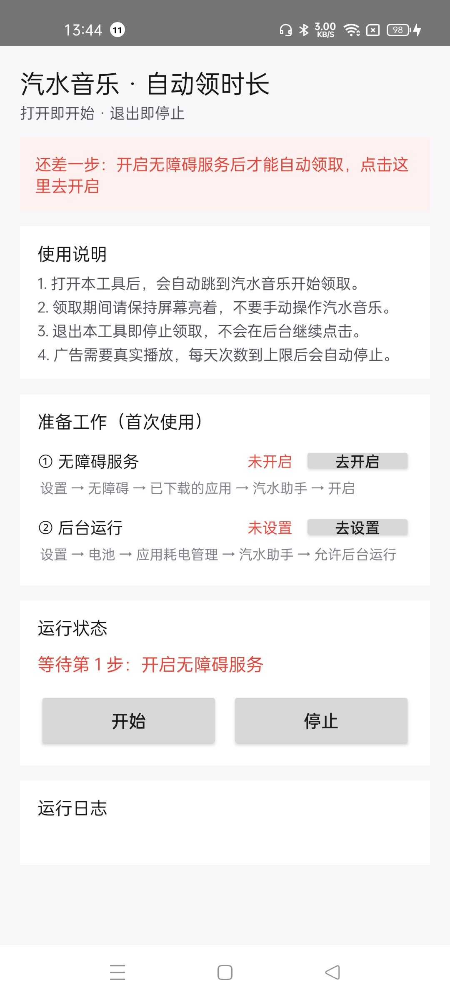
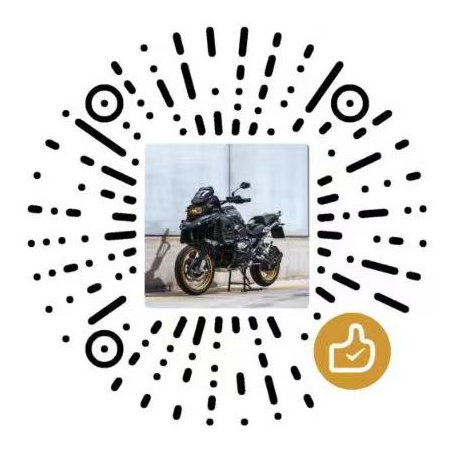

<div align="center">


# 汽水助手

自动完成汽水音乐「看广告领免费听」的 Android 工具。

Android 7.0+ · 无广告 · 不收费 · 源码公开

[**下载最新 APK**](https://github.com/wangshanhai/soda-helper/releases/latest/download/sodaHelper.apk) · [落地页](https://wangshanhai.github.io/soda-helper/)


</div>

> 本项目与汽水音乐、字节跳动无任何关联。仅供个人学习与 Android 自动化技术研究，使用可能违反平台用户协议，请自行评估风险。

## 它做什么

汽水音乐每天可以通过看广告领取免费听时长，但需要反复点击「继续领」、等待广告、关闭弹窗。

这个工具把这些重复操作交给无障碍服务自动完成：

- 打开工具后自动跳到汽水音乐，进入「我的」页点击「继续领」
- 等待广告播完，自动点「领取成功」和「坚持退出」
- 自动关闭「再看 N 个提前享」推荐弹窗
- 每轮校验进度是否真的增加，避免空转
- 达到每日上限或连续失败时自动停止

## 功能

- **打开即开始，退出即停止**：不需要定时任务，也不会在后台偷偷运行
- **悬浮进度窗**：实时显示第几轮、当前进度、运行状态，可拖动，带停止按钮
- **前台保活通知**：降低被 ColorOS 等系统冻结的概率
- **失败保护**：连续失败 3 次自动停止，不会无限循环
- **不收集账号、不上传数据**：全部逻辑在本机完成
- **无广告、不收费**：赞赏完全自愿

## 截图

| 工具首页 | 悬浮进度窗 |
| :---: | :---: |
|  |  |

## 下载与安装

1. 从 [Releases](https://github.com/wangshanhai/soda-helper/releases) 下载最新的 `sodaHelper.apk`
2. 在手机上允许「安装未知来源应用」
3. 安装后打开工具，按引导完成：
   - 开启无障碍服务：设置 → 无障碍 → 已下载的应用 → 汽水助手 → 开启
   - 开启悬浮窗：设置 → 应用管理 → 汽水助手 → 显示在其他应用上层
   - 允许后台运行：设置 → 电池 → 应用耗电管理 → 汽水助手 → 允许后台运行
4. 打开工具即自动开始；退出工具即停止

> OPPO / ColorOS 建议同时允许自启动，否则后台可能被冻结。更新 APK 前请先关闭无障碍，安装完成后重新开启，避免系统把服务标记为异常。

## 使用说明

- 首次使用需要手动授予无障碍、悬浮窗和电池白名单，这是 Android 的限制，无法自动完成
- 领取期间保持屏幕亮着，不要手动操作汽水音乐
- 悬浮窗可以拖动到不挡按钮的位置
- 达到每日次数上限后「继续领」会消失，工具会自动停止
- 如果首页显示「上次结束：xxx」，说明是主动停止或异常停止，可据此排查

## 常见问题

<details>
<summary>需要 root 吗？</summary>

不需要。工具使用 Android 无障碍服务模拟点击，不修改汽水音乐安装包。
</details>

<details>
<summary>支持哪些系统？</summary>

最低 Android 7.0（API 24），主要在 Android 11 的 OPPO 设备上验证。不同 ROM 的后台限制不同，可能需要额外允许自启动。
</details>

<details>
<summary>会不会封号？</summary>

自动化操作可能违反汽水音乐用户协议，存在账号被限制的风险。建议仅个人自用，不要多账号刷量或对外售卖。
</details>

<details>
<summary>为什么需要无障碍和悬浮窗？</summary>

无障碍用于读取页面控件和模拟点击；悬浮窗用于显示轮次、进度和停止按钮。工具不会读取你的账号密码，也不会上传任何数据。
</details>

<details>
<summary>为什么运行一段时间会停止？</summary>

可能是达到每日领取上限、连续失败 3 次，或达到 30 轮保护上限。首页会显示「上次结束：xxx」说明原因。
</details>

<details>
<summary>更新后无障碍失效了？</summary>

覆盖安装会重置无障碍授权。重新在系统设置里开启一次即可；建议更新前先关闭无障碍，安装后再开启。
</details>

## 从源码构建

环境要求：

- Windows
- JDK 11
- Android SDK：`build-tools 30.0.3`、`platforms/android-30`

```powershell
powershell -ExecutionPolicy Bypass -File .\build.ps1
```

产物：`dist/sodaHelper.apk`

说明：

- `build.ps1` 里的 `$sdk` 默认指向 `E:\Android Studio\Sdk`，请改成你自己的 Android SDK 路径
- `build.ps1` 会把工程复制到纯英文临时目录再编译，避免 aapt2 无法处理中文路径
- 首次构建会自动生成 `soda.keystore`，该文件已被 `.gitignore` 排除，请勿提交
- 官方 APK 使用作者自己的签名；如果你用新 keystore 重新构建，需要先卸载官方版本再安装，否则会签名冲突

## 项目结构

```text
sodaHelperNative/
├── src/com/soda/helper/
│   ├── MainActivity.java        # 首页、权限引导、赞赏提示
│   ├── DonateActivity.java      # 赞赏码页面
│   ├── SodaService.java         # 无障碍服务
│   ├── Engine.java              # 领取状态机
│   ├── FloatingProgress.java    # 悬浮进度窗
│   ├── KeepAliveService.java    # 前台保活
│   ├── StopReceiver.java        # 通知栏停止按钮
│   ├── DonatePrompt.java        # 一次性赞赏提示
│   ├── Logs.java                # 日志
│   └── Config.java              # 包名、控件 ID、轮次上限
├── res/                         # 图标、字符串、无障碍配置、赞赏码
├── docs/                        # GitHub Pages 落地页
├── AndroidManifest.xml
├── build.ps1
└── README.md
```

## 赞赏

这个工具不收费，也没有广告。如果它帮你自动看完了每天的广告、多听几天歌，愿意的话可以请我喝杯奶茶。

不着急，觉得有用再说。

<div align="center">

<br>
<sub>微信扫码赞赏</sub>
</div>

## 更新日志

### 0.2.7

- 识别「第30日畅听」弹窗，领满 30 天自动停止并提醒
- 支持跳过汽水开屏广告
- 新增通知权限引导（④ 通知提醒）
- 领满 30 天后悬浮窗停留展示结束原因，并发送完成通知

### 0.2.3

- 替换微信赞赏码
- 赞赏页文案改为「微信扫码赞赏」

### 0.2.2

- 赞赏页文案调整

### 0.2.0

- 新增前台保活通知，降低后台被冻结概率
- 轮次上限 12 → 30，连续失败上限 2 → 3
- 首页显示上次停止原因
- 新增一次性赞赏提示

### 0.1.9

- 新增「支持作者」页面和赞赏入口

### 0.1.8

- 新增悬浮进度窗
- 支持拖动、停止按钮、实时进度

## 免责声明

- 本项目与汽水音乐、字节跳动无任何关联
- 仅供个人学习与 Android 自动化技术研究
- 使用本工具可能违反汽水音乐用户协议，存在账号受限风险
- 请勿用于多账号刷量、售卖或其他商业用途
- 作者不对使用本工具造成的任何损失负责

## License

[MIT](LICENSE)
